  

  <a href="https://www.linkedin.com/in/abhay5100/">LinkedIn</a> &nbsp;·&nbsp;
  <a href="https://github.com/Abhay122710?tab=repositories">Repositories</a> &nbsp;·&nbsp;
  <a href="https://vendorplus.online/">Vendor+</a> &nbsp;·&nbsp;
  <a href="https://abhay122710.itch.io/geometry-dash-game">Play my game</a>

  
  
  

### A little about me

I'm a Computer Science & Engineering student at **UPES, Dehradun**, specializing in **Graphics & Gaming**. I build full-stack applications, explore AI-powered developer tools, and create interactive experiences in Unity. I also enjoy UI/UX design with Figma and 3D work with Blender.

**My toolkit:** C++ · Python · C# · React · TypeScript · Supabase · MySQL · Unity · Blender · Figma · Git

### Selected work

[Source code](https://github.com/Abhay122710/vendorplus) · [Live project](https://vendorplus.online/)

[Source code](https://github.com/Abhay122710/mnemosyne) · [Project website](https://mnemosyne-eosin.vercel.app/)

[Source code](https://github.com/Abhay122710/Geometry-Dash-Style-2D-Game) · [Play on itch.io](https://abhay122710.itch.io/geometry-dash-game)

Made with code & curiosity · <a href="./PROFILE_MAINTENANCE.md">How these cards work</a>

